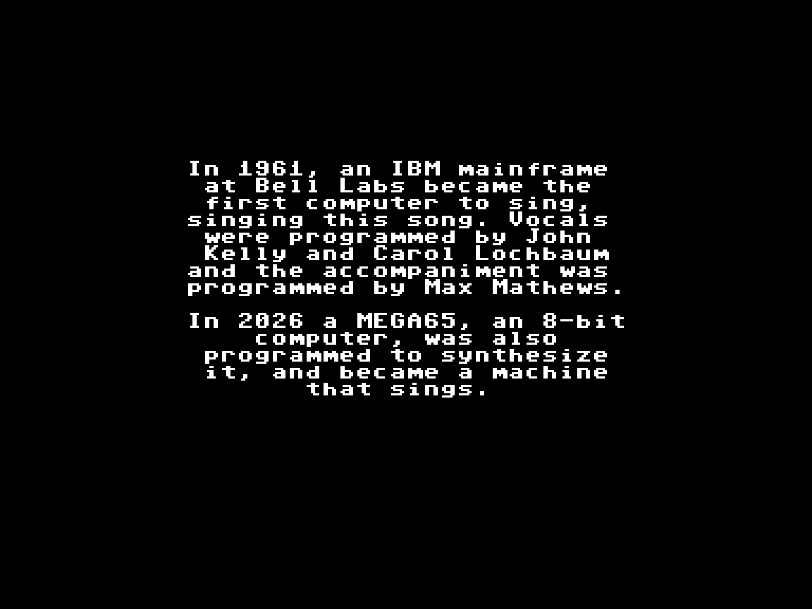

# Daisy Bell: A Machine that Sings

The MEGA65 sings "Daisy Bell".

A video of the whole show: [docs/daisy-bell.mp4](docs/daisy-bell.mp4). It is rendered on a PC from
the program's own output: the screen as the engine writes it, the voice from the reference model
the engine follows sample for sample, the SIDs from an emulation of the SID chip, an approximate
character set. The figures on its last screen are those the program measured on a MEGA65.

## Run

Needs a MEGA65 in PAL (50 Hz).

1. Copy `DAISY-BELL.D81` from the release to the SD card.
2. `MOUNT "DAISY-BELL.D81"`
3. `LOAD"*",8,1`, then `RUN`

Q quits from every screen. R on the last screen sings again.

## What it is

First the SIDs play the chorus of "Daisy Bell" (Harry Dacre, 1892) while its story is typed on
the screen. Then the MEGA65 sings it, and the lyrics appear as they are sung.

The voice is the vocal tract model that John L. Kelly Jr. and Carol Lochbaum published in 1962:
a tube of ten sections, computed live, sample by sample, 10,000 samples a second, and played by
the MEGA65's audio DMA. The SIDs accompany it. The last screen shows the share of the CPU the
voice took, as the program measured it while it sang: 40 % on the MEGA65 it was tested on.

Nothing is recorded: voice and music are worked out as it runs. Nothing of the 1961 recording is
used.

## Source

| Path | What |
|---|---|
| `src/daisy-bell.b65` | the program: readable BASIC 65 source |
| `src/psinco-card.b65` | the opening card |
| `dsp/gen_engine.py` | writes the engine (6502 code, called with `SYS`) |
| `dsp/synth.py` | the voice: the reference model the engine follows sample for sample |
| `dsp/kl.py`, `dsp/tables.py`, `dsp/fit_vowels.py`, `dsp/vowels.json` | the tube, its tables, the vowel shapes |
| `dsp/voice.py`, `dsp/score.py`, `dsp/song.py`, `dsp/vstream.py` | the singing rules, the song, the show's timeline, the streams |
| `dsp/test_engine.py` | runs the engine in a 6502 emulator against the model |
| `dsp/run_sings.py` | runs the program in the BASIC 65 simulator, with the engine |
| `dsp/preview.py`, `dsp/video.py`, `dsp/card.py`, `dsp/slide.py` | the listening preview, the video and the pictures, made on a PC |
| `tools/` | assembler driver, transpiler, tokeniser, BASIC 65 simulator, disk writer and checker |
| `build/` | the numbered listing, the program, the engine and the streams |

`sh build.sh` rebuilds the disk and runs the quick tests. The whole show in the emulator takes
about 20 minutes: `python3 dsp/test_engine.py build --strict`. It needs Python 3 with numpy,
scipy, py65 and d64; the preview also pyresidfp and ffmpeg.

## Tested on

A MEGA65 (R6A) in PAL, core 890-sdcard-native build #32, ROM 920422. The program handles NTSC,
but it has not been tested there.

## Credits

Daisy Bell: A Machine that Sings, 2026, by Dawid Blachowski, with Claude, Anthropic's AI.
psinco. A Software Atelier from Luxembourg.

"Daisy Bell", words and music by Harry Dacre, 1892, in the public domain.
The voice after J. L. Kelly Jr. and C. C. Lochbaum, Speech synthesis, Fourth International
Congress on Acoustics, Copenhagen, 1962. The vowels fitted to G. E. Peterson and H. L. Barney,
JASA 24 (1952); the glottal pulse after A. E. Rosenberg, JASA 49 (1971). All sources in
`docs/CREDITS.txt`, also on the disk.

MIT licence: free to use, change and share, with the notice. See [LICENSE](LICENSE).
